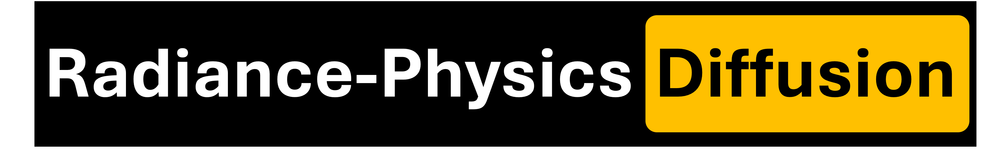
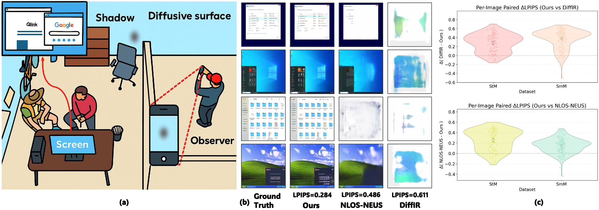
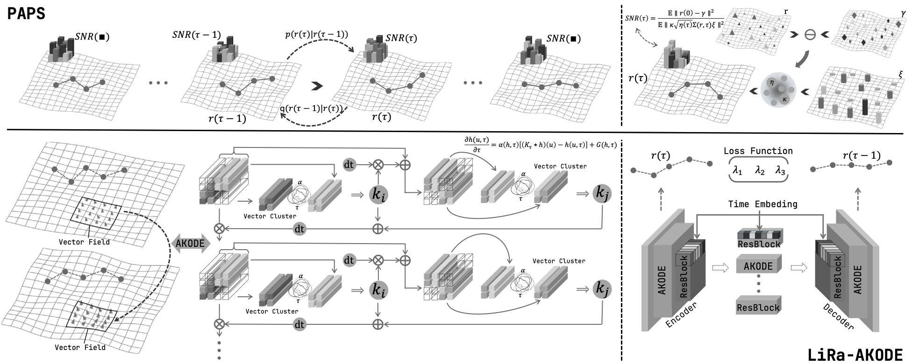
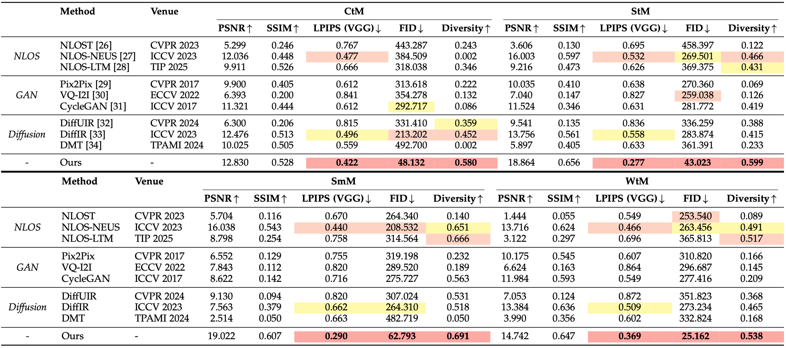
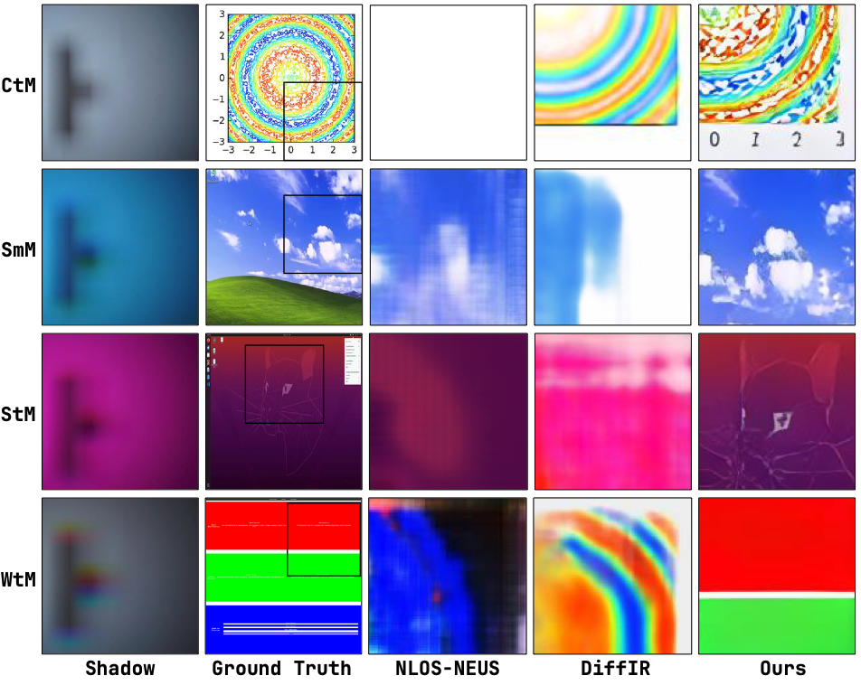
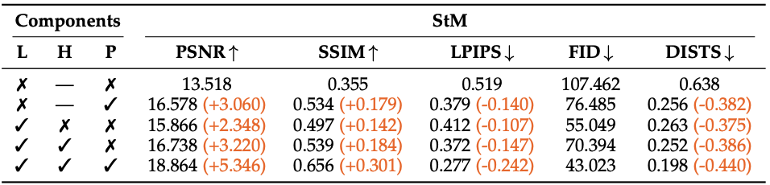
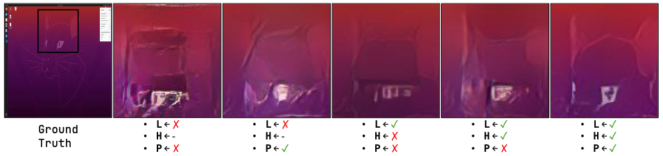
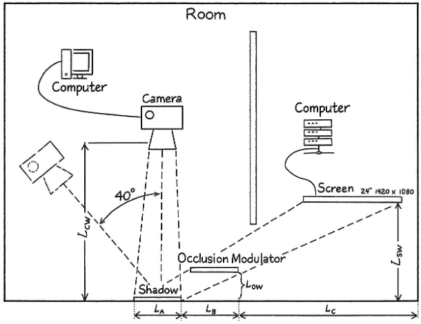

<br><br><br>

## 📌 What’s Available

| Component                        | Status         |
|----------------------------------|----------------|
| 📚 Model Definition              | ✅ Available   |
| 💻 Training Code                 | ✅ Available   |
| 🧪 Inference Code                | ✅ Available   |
| 🎯 Model Weights                 | ⏳ Coming Soon |
| 📊 Dataset                       | ⏳ Coming Soon |
---

## 📄 Paper Information

- **Title**: [Physics-Aware Generative Reconstruction Enables the Theft of Hidden Screen Content Solely from Light Leakage]
- **Status**: Accepted at [ACM MM 2026]

---

## 🎥 Abstract
Passive non-line-of-sight (NLOS) imaging promises remote awareness in safety-critical settings including search and rescue, privacy-preserving monitoring, autonomous robotics, and optical channel measurement attacks, where only a diffusive surface is visible. Yet single-shot reconstruction remains brittle: transport through the diffusive surface is strongly space-varying and couples near and far geometry, while photon statistics are heteroscedastic and easily confused with scene content. We present Radiance-Physics Diffusion (RaP-Diffusion), which treats the diffusive surface as a geometry- and noise-coded aperture. A Physics-Aware Photon Noise Synthesis forward process (PAPS) calibrates Poisson shot noise and Gaussian readout variability with signal-to-noise ratio (SNR) equalization, so the model learns sensor randomness rather than hallucinating it. A Liquid Radiance Adaptive-Kernel Ordinary Differential Equation denoiser (LiRa-AKODE) expands or contracts its receptive field according to local transport, preserving edges and long-range structure while staying within a Gaussian-conjugate reverse update. Across four datasets, CtM, StM, SmM and WtM, our single-image reconstructor improves PSNR, SSIM, LPIPS, FID, and diversity and remains stable under moderate viewpoint changes. On four indoor screen-content datasets and a 256×256 setting, RaP-Diffusion achieves the above gains with 48.41 ms latency on an RTX 5090, with 133.55M parameters and 39.90G FLOPs, indicating practical efficiency within these operating conditions.



## 🧭 Datasets 
The datasets (*CtM*, *SmM*, *StM* and *WtM*) will be made public after acceptance (**coming soon**).
> There are some dataset example images in **Datasets.tar.xz**.

## 💽 Weights of RaP-Diffusion
- Link: https://XXXXXXXXX.xxx/XXX
- Password: XXXX

## 🎞️ uv environment
- Python *3.10* and PyTorch *2.9.1*
- NVIDIA GeForce RTX 5090 GPUs (RAM 32G)

> pyproject.toml

> uv.lock

## 🖇️ Architecture of RaP-Diffusion



<br><br><br><br><br><br><br><br><br><br><br><br><br><br><br>

---

## 🛠️ Usage
### 🖥️ OS Release
```
VERSION_ID="22.04"
ID=ubuntu
ID_LIKE=debian
```

### 📦 Create Environment
```shell
sudo apt update
sudo apt install curl
curl -LsSf https://astral.sh/uv/install.sh | sh   # install uv
uv sync                                           # Synchronous UV Environment
```

### 📊 The structure of each dataset (CtM, SmM, StM, WtM)
```shell
.
├── train
│    ├── A
│    │   └── a.png
│    │    ...
│    └── B
│        └── a.png
│   	    ...
├── val
│    ├── A
│    │   └── b.png
│    │    ...
│    └── B
│        └── b.png
│         ...
└── test 
     ├── A
     │   └── c.png
     │    ...
     └── B
         └── c.png
          ...
```

---

## 💾 Results

<details>
<summary>Performance (click me)</summary>
<p align="center">
  
</p>
<p align="center">
  
</p>
</details>

<details>
<summary>Ablation (click me)</summary>
<p align="center">
  
</p>
<p align="center">
  
</p>
</details>

<details>
<summary>Top-down room schematic (click me)</summary>
<p align="center">
  
</p>
</details>

---

> [!WARNING]
> The datasets we collected and the experiments we conducted strictly complied with local laws.

> [!CAUTION]
> This project is released under the Apache 2.0 license.
